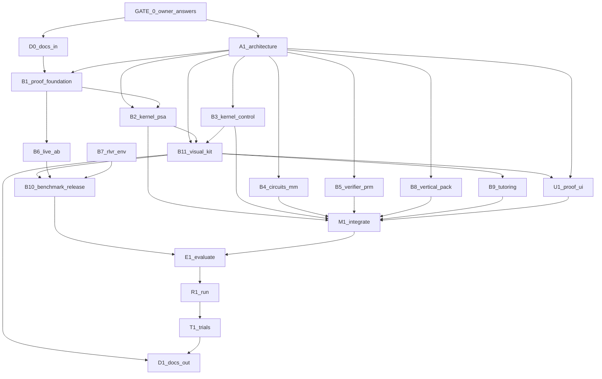

# Execution graph: Arc frontier upgrade (Nov 2026)

> **This is the execution program.** Scope contract lives in [PLAN.md](PLAN.md). **Gate 0 answered 2026-11-13** (see [GATE_0_QUESTIONS.md](GATE_0_QUESTIONS.md)). **Do not start code waves until the owner merges this plan and kicks off execution.**

---

## Metadata

| Field | Value |
|-------|-------|
| **Scope plan** | [PLAN.md](PLAN.md) |
| **Objective** | Ship a provably frontier UG EE co-solver: deterministic engines + **Arc Visual Kit** + public benchmarks + LIVE host A/B. |
| **Topology mix** | Diamond + pipeline (proof spine serial; kernel slices parallel) |
| **Depth** | 2 (graph → node plans) |
| **Graph-engineering** | Named; approval starts execution immediately |
| **Gate 0** | **Answered** 2026-11-13 (Vinayak); execution **waits on plan merge** |

---

## Node plans

| ID | Name | Plan |
|----|------|------|
| D0 | Docs-in sync | [nodes/D0-docs-in.md](nodes/D0-docs-in.md) |
| A1 | Architecture freeze | [nodes/A1-architecture.md](nodes/A1-architecture.md) |
| U1 | Proof surfaces UX | [nodes/U1-proof-ui.md](nodes/U1-proof-ui.md) |
| B1 | Proof foundation fix | [nodes/B1-proof-foundation.md](nodes/B1-proof-foundation.md) |
| B2 | Kernel PSA wire | [nodes/B2-kernel-psa.md](nodes/B2-kernel-psa.md) |
| B3 | Kernel control depth | [nodes/B3-kernel-control.md](nodes/B3-kernel-control.md) |
| B4 | Circuits + multimodal | [nodes/B4-kernel-circuits-mm.md](nodes/B4-kernel-circuits-mm.md) |
| B5 | Verifier + trap PRM | [nodes/B5-verifier-prm.md](nodes/B5-verifier-prm.md) |
| B6 | LIVE host A/B harness | [nodes/B6-live-ab.md](nodes/B6-live-ab.md) |
| B7 | RLVR environment pack | [nodes/B7-rlvr-env.md](nodes/B7-rlvr-env.md) |
| B8 | Vertical EE pack + MCP | [nodes/B8-vertical-pack.md](nodes/B8-vertical-pack.md) |
| B9 | Tutoring mode | [nodes/B9-tutoring.md](nodes/B9-tutoring.md) |
| B10 | Public benchmark release | [nodes/B10-benchmark-release.md](nodes/B10-benchmark-release.md) |
| B11 | Arc Visual Kit | [nodes/B11-visual-kit.md](nodes/B11-visual-kit.md) |
| M1 | Integrate + barrier | [nodes/M1-integrate.md](nodes/M1-integrate.md) |
| E1 | Evaluate gates | [nodes/E1-evaluate.md](nodes/E1-evaluate.md) |
| R1 | Run (boot smoke) | [nodes/R1-run.md](nodes/R1-run.md) |
| T1 | Trials pass^k | [nodes/T1-trials.md](nodes/T1-trials.md) |
| D1 | Docs-out + PR proof | [nodes/D1-docs-out.md](nodes/D1-docs-out.md) |

---

## Lifecycle

| Stage | Node id(s) | Plan / N/A |
|-------|------------|------------|
| Research + questions | R0 | Complete (reports + [GATE_0_QUESTIONS.md](GATE_0_QUESTIONS.md)) |
| Docs-in | D0 | [D0](nodes/D0-docs-in.md) |
| Architecture | A1 | [A1](nodes/A1-architecture.md) |
| Design / UI UX | U1 | [U1](nodes/U1-proof-ui.md) |
| Build | B1..B11 | Linked above |
| Integrate | M1 | [M1](nodes/M1-integrate.md) |
| Evaluate | E1 | [E1](nodes/E1-evaluate.md) |
| Run | R1 | [R1](nodes/R1-run.md) |
| Trials | T1 | [T1](nodes/T1-trials.md) |
| Docs-out | D1 | [D1](nodes/D1-docs-out.md) |

---

## Mermaid

**Edges cut (no arrow):** B3, B4, B5, B11 are parallel until M1 (B11 reads engine contracts from B2/B3 but does not block their start). B7 can start after B1 schema. B9 is P1; needs B11 component ids for figure-backed tutoring.

---

## Waves

| Wave | Nodes | Fan-out? | Barrier? | Status | Lead plumbing |
|------|-------|----------|----------|--------|---------------|
| 0 | GATE_0 | no | yes | **done** | Locked in GATE_0_QUESTIONS.md |
| 1 | D0, A1 | yes | no | pending | DECISIONS + Visual Kit ADR |
| 2 | B1 | no | no | pending | n/a |
| 3 | B2, B3, B4, B5, B8, B11, U1 | yes | no | pending | B11 owns `packages/visual-kit/**` |
| 4 | B6, B7, B9 | yes | no | pending | B9 optional P1 |
| 5 | M1 | no | yes | pending | Merge + conflict resolve |
| 6 | B10 | no | no | pending | Consumes B6 + B7 artifacts |
| 7 | E1 | no | no | pending | n/a |
| 8 | R1, T1 | yes | no | pending | n/a |
| 9 | D1 | no | no | pending | Frontier PR + scorecard |

---

## Edges (data contracts)

| From | To | Data name | Kind |
|------|----|-----------|------|
| GATE_0 | A1 | `gate0_answers.json` | agent |
| GATE_0 | B6 | `ab_host_models` | agent |
| D0 | B1 | `doc_truth_manifest` | plumbing |
| A1 | B2..B11 | `capability_delta_spec` | agent |
| B2 | B11 | `psa_series_payload` | agent |
| B3 | B11 | `control_plot_payload` | agent |
| B11 | U1 | `visual_manifest` | agent |
| B11 | B10 | `benchmark_figure_bundle` | agent |
| B11 | D1 | `readme_media_manifest` | agent |
| B1 | B2 | `eval_schema_v2` | agent |
| B1 | B6 | `trap_suite_index` | agent |
| B2 | M1 | `psa_dag_wiring` | agent |
| B6 | B10 | `live_ab_results` | agent |
| B7 | B10 | `rlvr_env_manifest` | agent |
| M1 | E1 | `integrated_manifest` | plumbing |
| T1 | D1 | `proof_artifacts_bundle` | agent |

---

## Failure

- Task throw/empty → null; wave continues except B1 (serial spine).
- B1 failure blocks wave 3 (eval schema).
- Cycle N/A (fixed graph).

---

## Commit mapping (summary)

| Node | §9 rows | Gate |
|------|---------|------|
| D0 | 1 | `scripts/check_doc_drift.sh` (new) |
| A1 | 2 | ADR review |
| B1 | 3 | `electrical-engineer eval` no KeyError |
| B2 | 4 | PSA gold CLI PASS |
| B3 | 4 | ControlEval subset green |
| B4 | 5 | CIRCUIT subset + ngspice |
| B5 | 3 | trap hooks tests |
| B6 | 3 | LIVE A/B artifact JSON |
| B7 | 2 | env package import |
| B8 | 3 | MCP smoke |
| B9 | 2 | tutoring gold (P1) |
| B10 | 2 | benchmark tarball |
| B11 | 5 | visual regression + MCP |
| U1 | 2 | UI smoke + visual gallery |
| M1 | 2 | full pytest |
| E1 | 1 | validate frontier |
| R1 | 1 | boot smoke |
| T1 | 1 | pass^k report |
| D1 | 2 | readme proof section |

Lead owns git. One matrix row per commit. See [PLAN.md](PLAN.md) §9 for full table.

---

## Approval implication

After **plan merge**, start **wave 1** immediately. Node agents load **only** their linked plan file. Human checkpoints: LIVE AB API budget; visual golden bumps.
