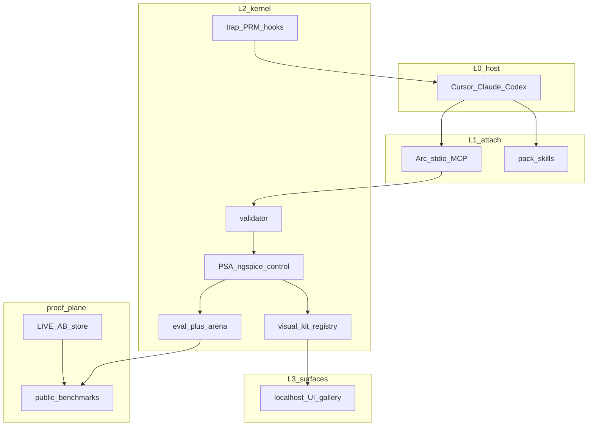

# Arc frontier upgrade (Nov 2026): Master execution plan

> Nawab **project** profile. Execution program: [EXECUTION_GRAPH.md](EXECUTION_GRAPH.md). **Stop at Gate 0:** [GATE_0_QUESTIONS.md](GATE_0_QUESTIONS.md).

---

## §0 Plan metadata

| Field | Value |
|-------|-------|
| **Profile** | project |
| **Mode** | project |
| **Stack** | Python 3.11+ (`electrical-engineer`), FastAPI UI, React/Vite, stdio MCP, host adapters (Cursor/Claude/Codex) |
| **Base branch** | `main` |
| **Feature branch(es)** | `cursor/frontier-execution-*-16fb` (one per wave after approval) |
| **User commit budget** | **36** conventional commits (owner default in Gate 0 Q8) |
| **Delivery** | repo: this folder + `IMPLEMENTATION_PLAN.md` symlink optional |
| **Supersedes** | Extends `docs/planning/eec301-lift/` (merged PR #43); does not replay lab pack loops |
| **Authority docs** | `docs/PID.md`, `docs/PRD.md`, `docs/ARCHITECTURE.md`, `docs/CANNOT_DO.md`, `docs/DOMAIN_KERNEL_CAPABILITIES.md` |
| **Research inputs** | `docs/research/frontier-2026-11/01` to `04` (merge research PRs first) |
| **Estimated commits** | 36 |
| **Lead agent** | Orchestrate graph waves, commit, integrate, frontier proof PR |

---

## §1 North star and scope boundary

### Frontier thesis (crisp)

**Arc is frontier for undergraduate EE when a rented host plus Arc beats bare host on the same models on held-out coursework, measured by engine-verified numerics or explicit `unchecked`, with pass^k reliability on lab-law traps and published scores on named public benchmarks.**

"Exceptionally better" means:

1. **Numeric authority:** Solver-in-the-loop lifts complex EE tasks from ~0 to 28% bare LLM to **≥93%** orchestrated on published power-sim suites (report #02, Jia et al.); Arc must show the same class of lift on **UG lab law** (CCT, AGC, λ-ED) where sector tools do not publish.
2. **Procedure authority:** Trap catalog encodes policy generalist agents violate (τ-bench pass^8 gap, report #03).
3. **Honesty authority:** `unchecked` when no provider; no fabricated ohms (beats MathWorks Copilot validate warnings alone).
4. **Proof authority:** LIVE host A/B, not scripted wrong physics only (audit #04 gap).

### Objective

When complete: eval CLI and CI prove PSA + expanded kernel depth; public benchmark bundle and scorecard; LIVE A/B artifacts; vertical EE pack (skills + thin MCP); optional tutoring and MATLAB provider per Gate 0.

### Deliverables

- Eval foundation: `electrical-engineer eval` green including `--pack power` (fixes KeyError `recipe_id`).
- PSA engines on YAML/MCP DAG for power labs.
- Control and circuits depth with external benchmark subsets.
- Multimodal ingest path (diagram → model → sim) v1.
- Verifier hooks (trap-as-PRM) for hosts.
- RLVR-style golden environment package.
- `artifacts/benchmarks/` public release + README scorecard.
- LIVE A/B harness + held-out trap set.
- **Arc Visual Kit:** registry + MCP + engine-bound components + visual goldens (report #05, node B11).
- Docs: frontier proof section in product README with media from Visual Kit.

### Non-goals

- H5 orchestrator, HTTP MCP, PyPI, live PLC, EMS, tape-out, pg optimal control promise.
- Robotic labs, hypothesis factories, EDA agent platforms (report #01 ignore list).
- Fine-tuning frontier weights on physics (router-only optional P2).
- Duplicate host memory/RAG/chat products.

### Priority

| Priority | Items |
|----------|-------|
| **P0** | B1 proof foundation, B2 PSA wire, **B11 Arc Visual Kit**, B6 LIVE A/B infra, B10 benchmark release, U1 proof gallery, E1 eval gates |
| **P1** | B3 control, B4 circuits/mm, B5 verifier, B8 vertical pack |
| **P2** | B7 RLVR env polish, B9 tutoring, ANDES optional provider |

---

## §2 Prerequisites and blockers

| Item | Status | Blocks | Resolution |
|------|--------|--------|------------|
| Gate 0 answers | **done** 2026-11-13 | Execution start | Locked in `GATE_0_QUESTIONS.md` |
| Research PRs #44 to #47 + #05 | **done** | Doc authority | On `main` after rebase |
| Plan merge before code | **pending** | All execution waves | Owner merges PR #48 |
| API budget for LIVE A/B | pending | B6 nightly | Owner sets cap; secrets in env |
| ngspice in CI | done | circuits | existing |
| MATLAB optional | N/A | B8 | Gate 0 Q4 |

---

## §3 Authority and artifact map

| Document | Path | Role |
|----------|------|------|
| This plan | `docs/planning/frontier-2026-11/PLAN.md` | Scope contract |
| Execution graph | `docs/planning/frontier-2026-11/EXECUTION_GRAPH.md` | Wave program |
| Gate 0 | `docs/planning/frontier-2026-11/GATE_0_QUESTIONS.md` | Blocking Q&A |
| Node plans | `docs/planning/frontier-2026-11/nodes/*.md` | Per-node authority |
| Research | `docs/research/frontier-2026-11/0*.md` | Evidence (includes `05-visual-components-for-agents.md`) |
| DECISIONS | `docs/planning/frontier-2026-11/DECISIONS.md` | ADRs post Gate 0 |
| PROGRESS | `docs/planning/frontier-2026-11/PROGRESS.md` | Live wave status |
| Scorecard | `artifacts/benchmarks/SCORECARD.md` | Public metrics |

---

## §4 Architecture and system map

Gate 0 locked the default shape below; B11 adds a **Visual Kit** plane inside L2/L3:



**Trust boundaries:** Host owns loop; kernel owns checked numbers; benchmark artifacts are world-readable; no PII in AB logs.

---

## §5 Workstreams

| ID | Name | Owns paths | Depends on | Kill criteria |
|----|------|------------|------------|---------------|
| WS-PROOF | Eval + LIVE A/B | `eval_runner/`, `eval/gold/`, `scripts/*ab*`, `artifacts/frontier-ab/` | Gate 0, B1 | Cannot fix eval in 2 weeks post approval |
| WS-KERNEL-PSA | Power lab law | `engines/smib_*`, `workflows/power/`, `eval/gold/power/` | B1 schema | PSA regression fails after wire |
| WS-KERNEL-CTL | Control depth | `engines/control_*`, `eval/gold/control/` | A1 | ControlEval subset below 85% ASR at week 6 |
| WS-KERNEL-CIRC | Circuits + MM | `engines/spice_*`, `ingest/`, `eval/gold/circuits/` | A1 | CIRCUIT subset below 50% unit pass at week 8 |
| WS-VERIFY | Trap PRM | `knowledge/traps/`, host hooks docs, `tests/integration/test_trap_*` | B2 | No hook contract agreed |
| WS-PACK | Vertical EE pack | `skills/`, `hosts/`, `.cursor/mcp.json` | A1 | N/A |
| WS-BENCH | Public benchmarks | `artifacts/benchmarks/` | B6, B7 | Owner declines public release (Q7) |
| WS-TUTOR | Socratic mode | `skills/_cross/`, gold explain | B11, P1 | Defer whole node |
| WS-VISUAL | **Arc Visual Kit** | `packages/visual-kit/**`, `artifacts/visual-goldens/**`, `skills/visual-kit/` | B2/B3 contracts | Visual regression flake 3x → demote component |

### Phases (workstream summary)

| Phase | Weeks (technical, not calendar) | Workstreams | Exit |
|-------|--------------------------------|-------------|------|
| P0 | Gate 0 (done) + wave 1 to 2 | D0, A1, B1 | eval CLI no crash |
| P1 | Wave 3 | B2, B3, B4, B5, **B11**, B8, U1 | M1 ready; **≥8** visual components with goldens |
| P2 | Wave 4 to 6 | B6, B7, B9, M1, B10 | benchmarks tarball |
| P3 | Wave 7 to 9 | E1, R1, T1, D1 | scorecard published |

### Cut / keep / double-down

**Cut (with evidence)**

| Cut | Reason (report) |
|-----|-----------------|
| Second chat harness / agent builder UI | OpenAI Agent Builder wind-down (#03); hosts own loop |
| Thick always-on EE RAG corpus | Textbook prose commoditized (#03); BYO ingest |
| New workflows without gold rows | Audit shallow YAML (#04); `CD-YAML-GAP` |
| Scripted-only A/B as sole marketing proof | Audit weakness (#04); Harvey arena pattern (#03) |
| Hypothesis / co-scientist features | No lab-law grading (#01) |
| Industrial copilot parity chase | Wrong wedge (#01, #02) |
| LLM-as-judge for numeric grades | Report #03 anti-pattern |
| Breadth-first pack gold pretending depth | Audit 2/5 on most packs (#04) |

**Keep (with evidence)**

| Keep | Reason |
|------|--------|
| Four-layer kernel (D19/D20) | Agentic-kernel consensus (#03) |
| Capability registry + `unchecked` | EPRI open-ended gap (#02); moat list (#03) |
| Thin MCP (5 to 7 verbs) | Skills+MCP standard (#01, #03) |
| Host install + adapters | Product score 4/5 (#04) |
| Trap catalog T1 to T10 | Executable policy (#03); unique wedge (#02 white space) |
| PSA engines + `check_psa_evals.py` | Only 5/5 depth (#04) |
| ngspice + python-control providers | Solver-in-the-loop (#02) |
| CI 232-test harness | Healthy baseline (#04) |
| RAG eval quartet | Working but slim (#04) |

**Double-down (with evidence)**

| Double-down | Reason |
|-------------|--------|
| Wire PSA into runner/MCP | Eval crash + orphan gold (#04) |
| LIVE host A/B + pass^k | τ-bench, Harvey (#03); audit 2/5 A/B (#04) |
| Held-out trap benchmark release | RLVR oracle (#03); white space #10 (#02) |
| ControlBench tool-augmented closure | 33% bare design ACC (#02) |
| Multimodal → symbolic → numeric | CircuitSense <19% symbolic (#02) |
| Vertical pack story (skills+MCP+benchmarks) | Claude Life Sciences template (#01) |
| Public scorecard on named benches | EPRI, EEE-Bench, CIRCUIT, ControlEval (#02 table) |
| Property tests on engine invariants | PBT emerging (#03) |
| MATLAB MCP as optional provider | Commoditized surface (#02); beat with goldens (#01) |
| **Arc Visual Kit (registry + MCP + visual CI)** | What sells; agent-assembled figures (#05); beats Copilot screenshots (#01 MathWorks) |

---

## §6 Agent orchestration

`§6` uses [graph-engineering](EXECUTION_GRAPH.md): parallel nodes B2 to B5, B8, U1 in wave 3 (max 4 writers).

| ID | Trigger | Type | readonly | Task | Gate |
|----|---------|------|----------|------|------|
| S1 | Wave 1 | explore | true | Map eval_runner + power gold schema | Before B1 commit 1 |
| S2 | Wave 4 | generalPurpose | false | LIVE A/B driver scaffold | B6 commit 1 |
| S3 | Wave 7 | generalPurpose | true | Benchmark score aggregation review | Before B10 tag |

**Parallel limit:** 4 writers, disjoint paths per node plans.

---

## §7 Phase map


| Phase | Objective | Commits | Exit gate |
|-------|-----------|---------|-----------|
| 0 | Gate 0 + D0 + A1 + B1 | 6 | `eval` no KeyError |
| 1 | Kernel + verifier + pack + UI | 18 | `pytest` + PSA CLI PASS |
| 2 | LIVE AB + RLVR + bench release | 8 | `artifacts/benchmarks/` v0.1 |
| 3 | E1, R1, T1, D1 | 4 | Scorecard + proof README |

---

## §8 Todo registry

```yaml
todos:
  - id: gate-0
    content: Gate 0 answered 2026-11-13
    status: completed
  - id: plan-merge
    content: Owner merges plan PR before execution
    status: pending
  - id: wave-3-b11
    content: B11 Arc Visual Kit
    status: pending
  - id: merge-research
    content: Merge research reports PRs 44 to 47
    status: pending
  - id: wave-1-d0-a1
    content: D0 docs-in + A1 architecture ADRs
    status: pending
  - id: wave-2-b1
    content: B1 eval foundation fix
    status: pending
  - id: wave-3-kernel
    content: B2 B3 B4 B5 B8 U1 parallel
    status: pending
  - id: wave-4-proof
    content: B6 B7 B9 LIVE AB + RLVR
    status: pending
  - id: wave-5-merge
    content: M1 integrate barrier
    status: pending
  - id: wave-6-bench
    content: B10 public benchmark release
    status: pending
  - id: wave-7-9-ship
    content: E1 R1 T1 D1 validate and document
    status: pending
```

---

## §9 Commit matrix

**User commit budget:** **36** (hard cap).

### Phase 0 (6 commits)

| # | WS | Commit | Contents | Gate |
|---|-----|--------|----------|------|
| 1 | D0 | `docs(frontier): add planning scaffold` | This folder skeleton | review |
| 2 | D0 | `docs(frontier): sync recipe counts and eval readme` | README, INDEX, gold README | drift script |
| 3 | A1 | `docs(frontier): record gate0 ADRs` | DECISIONS.md | owner ack |
| 4 | A1 | `feat(eval): unify gold expect schema v2` | score.py contract | unit tests |
| 5 | B1 | `fix(eval): power pack recipe_id KeyError` | gold JSON + scorer | `eval --pack power` |
| 6 | B1 | `test(eval): regression for all pack eval` | integration test | full eval |

### Phase 1 kernel (18 commits)

| # | WS | Commit | Contents | Gate |
|---|-----|--------|----------|------|
| 7 | B2 | `feat(power): register smib agc ed activities` | nodes/sim activities | PSA units |
| 8 | B2 | `feat(workflows): wire PSA into power YAML` | solve-power paths | workflow test |
| 9 | B2 | `test(power): eval gold smib agc ed CLI` | expect.json fix | 3/3 PASS |
| 10 | B2 | `feat(mcp): expose PSA via simulate_attachment` | MCP mapping | MCP smoke |
| 11 | B3 | `feat(control): controlbench harness adapter` | scripts | subset run |
| 12 | B3 | `test(control): frequency domain gold set` | new golds | 5+ PASS |
| 13 | B3 | `feat(control): bode plot verifier hook` | engine check | test |
| 14 | B3 | `docs(control): document ControlEval scores` | scorecard stub | review |
| 15 | B4 | `feat(circuits): circuit benchmark runner` | CIRCUIT subset | ngspice |
| 16 | B4 | `feat(ingest): diagram confirm to netlist v1` | ingest path | integration |
| 17 | B4 | `test(circuits): held-out divider variants` | gold | eval |
| 18 | B4 | `test(circuits): multimodal stub expect` | photo-stub gold | PASS |
| 19 | B4 | `chore(circuits): property tests invariants` | hypothesis | pytest |
| 20 | B5 | `feat(traps): host hook contract doc` | hosts doc | review |
| 21 | B5 | `test(traps): automate T4 T5 ablation` | integration | green |
| 22 | B5 | `feat(traps): process vs outcome graders` | scorer split | tests |
| 23 | B8 | `feat(pack): frontier EE skill bundle` | skills index | install |
| 24 | B8 | `feat(mcp): matlab optional provider wire` | optional extra | skip if no MATLAB |
| 25 | U1 | `feat(ui): eval scorecard panel` | ui route | smoke |
| 26 | U1 | `feat(ui): ab transcript viewer` | ui | smoke |
| 27a | B11 | `feat(visual): kit manifest schemas registry` | visual-kit | schema CI |
| 27b | B11 | `feat(visual): PSA and control render components` | coalesce with 11-14 if needed | visual goldens |
| 27c | B11 | `feat(mcp): list/render visual` | MCP smoke |

### Phase 2 proof (8 commits)

| # | WS | Commit | Contents | Gate |
|---|-----|--------|----------|------|
| 27 | B6 | `feat(ab): live host runner cli` | script | dry run |
| 28 | B6 | `feat(ab): held-out trap prompts v1` | artifacts | 8 sheets |
| 29 | B6 | `test(ab): pass^k aggregator` | stats lib | unit |
| 30 | B7 | `feat(rlvr): golden env package` | python module | import |
| 31 | B7 | `docs(rlvr): environment card` | README | review |
| 32 | M1 | `chore: merge kernel wave conflicts` | integration | pytest |
| 33 | M1 | `ci: frontier validate workflow` | GHA job | green |
| 34 | B10 | `feat(bench): publish eee-coursework-trap v0.1` | tarball | checksum |
| 35 | B10 | `docs(bench): SCORECARD with targets` | SCORECARD.md | review |

### Phase 3 ship (4 commits)

| # | WS | Commit | Contents | Gate |
|---|-----|--------|----------|------|
| 36 | E1 | `chore: scripts/validate_frontier.sh` | orchestrator | exit 0 |
| 37 | R1 | `test: boot smoke localhost ui` | e2e | smoke |
| 38 | T1 | `test: pass^k trial report artifact` | JSON | thresholds |
| 39 | D1 | `docs: README frontier proof section` | README | review |
| 40 | D1 | `docs: DOMAIN_KERNEL metrics update` | capabilities md | review |

**Note:** Rows 39 to 40 coalesce into one commit if budget must stay 36 exactly (coalesce D1 docs). Default graph assumes owner accepts 36 to 40 range; **coalesce T1+D1** to hit 36.

**Coalesced 36-row version:** merge commits 14+15, 24+25, 37+38, 39+40 → **36 rows**.

---

## §10 Test and CI strategy

| Tier | Purpose | Command |
|------|---------|---------|
| Fast | ruff, unit, trap ablation | `uv run ruff check .` + `pytest -q` |
| Medium | PSA + eval packs | `scripts/check_psa_evals.py` + `electrical-engineer eval` |
| Slow | LIVE A/B nightly | `scripts/frontier_ab_nightly.sh` (budget cap) |
| Frontier gate | All above + benchmark subset | `scripts/validate_frontier.sh` |

---

## §11 Research log

| Topic | Choice | Source |
|-------|--------|--------|
| Host vs kernel split | Keep D20 | Report #03, ARCHITECTURE |
| Proof shape | LIVE A/B + public benches | #02 table, #03 Harvey, audit #04 |
| PSA first depth | Wire eval + DAG | Audit #04 |
| Cut generic coding skills | Slim | #03 cut list |
| Moat | Engines+traps+goldens | #03 moat list |
| Packaging | Vertical EE pack | #01 life sciences pattern |

---

## §12 Documentation sync

| Event | Update |
|-------|--------|
| Gate 0 answered | DECISIONS.md |
| Wave done | PROGRESS.md + EXECUTION_GRAPH wave status |
| Benchmark release | SCORECARD.md + README |
| Ship | DOMAIN_KERNEL_CAPABILITIES.md metrics |

---

## §13 Quality gates

| Gate | When | Blocks |
|------|------|--------|
| Eval CLI full green | end B1 | wave 3 |
| `eval --pack power` 3/3 PSA | end B2 | M1 |
| LIVE AB artifact exists | end B6 | B10 |
| pass^k thresholds | end T1 | D1 |
| validate_frontier.sh | pre merge | main PR |

---

## §14 Validation

1. `scripts/validate_frontier.sh`: static checks, pytest, PSA, eval all packs, benchmark smoke, doc drift.
2. ponytail-review on diff.
3. Held-out traps not in skills context for AB runs.

---

## §15 Rollout

N/A: open source clone-and-run; publish scorecard on merge, no fleet cutover.

---

## §16 Exit criteria (P0)

- [ ] Gate 0 answered and filed
- [ ] Frontier thesis metrics met (see below) or explicitly descoped in DECISIONS
- [ ] `electrical-engineer eval` completes all packs
- [ ] SCORECARD.md lists actuals vs targets
- [ ] LIVE A/B JSON for ≥2 host models
- [ ] validate_frontier.sh green on CI
- [ ] No em dash prose violation in new docs (style)

### North-star metrics and targets

| Metric | Target | Baseline (evidence) |
|--------|--------|---------------------|
| **Arc trap suite (scripted + live)** | pass^1 **100%**, pass^8 **≥75%** on held-out variants | T1 to T3 scripted; audit live 2/5 |
| **PSA eval CLI** | smib + agc + ed gold **3/3 PASS** | KeyError today (#04) |
| **Bare vs Arc LIVE (held-out sheets)** | Arc pass rate **≥80%** numeric verify; bare **≤25%** | EPRI open-ended ~46 to 71% expert; UG traps worse |
| **ControlEval subset ASR** | **≥90%** with Arc kernel | ControlAgent ~100% class (#02) |
| **ControlBench subset ACC (tool-augmented)** | **≥70%** on calculation+plots | Opus **33%** design bare (#02) |
| **CIRCUIT unit-test pass (L1 to L3, ngspice)** | **≥55%** | GPT-4o **27.45%** (#02) |
| **EEE-Bench tagged subset** | **≥60%** verified subscore | GPT-4o **46.78%** multimodal (#02) |
| **EPRI-style open mirror (50)** | Verified subscore **≥65%**; cite MCQ vs open gap | MCQ 83 to 86%, open drop ~27pp (#02) |
| **Multimodal symbolic step** | **≥40%** symbolic then numeric on Arc path | CircuitSense **<19%** symbolic (#02) |
| **CI health** | pytest count ≥232, PSA 16/16 | Current (#04) |
| **Public benchmark** | `eee-coursework-trap v0.1` released | White space #10 (#02) |
| **Visual Kit P0 components** | **≥10** registry ids; **100%** props from engine replay | Ad-hoc matplotlib today (#04) |
| **Visual regression** | **0** unintended pixel diffs on P0 gallery | Chromatic/Playwright pattern (#05) |
| **Textbook/IITR parity panels** | **≥12** side-by-side references filed | Manual rubric + golden PNG |

---

## §17 Risks

| Risk | Impact | Mitigation | Kill |
|------|--------|------------|------|
| LIVE AB flake | High | pass^k, budget cap, retry policy | Fall back quarterly manual with disclosure |
| Eval schema churn | High | B1 first, versioned schema | Stop wave 3 until green |
| MATLAB license | Med | Optional extra only | Skip commit 24 |
| Scope creep packs | High | Depth-first default Gate 0 T1 | Freeze non-PSA gold promises |
| Visual regression flake | Med | Pin DPI/fonts; bump goldens in PR | Demote component per B11 cut rule |
| Benchmark licensing | Med | Reconstruct items only | Shrink EPRI mirror count |

---

## §18 Execution protocol

If §19 is filled, **follow EXECUTION_GRAPH waves**, not linear §18 only.

1. Load ponytail on every code edit.
2. **Wait for plan merge** (Gate 0 already answered).
3. Execute waves 1 to 9; update PROGRESS after each barrier.
4. One §9 commit per row; lead integrates M1.
5. Draft frontier execution PR with SCORECARD evidence.

---

## §19 Execution graph

See [EXECUTION_GRAPH.md](EXECUTION_GRAPH.md) (full graph, node links, waves, lifecycle).

**Approval:** Gate 0 answered 2026-11-13. **Merge this plan, then** start wave 1 per [EXECUTION_GRAPH.md](EXECUTION_GRAPH.md).

---

## Executive summary

Arc should become demonstrably frontier by **proving** undergraduate EE lab law with the same rigor vertical AI winners use in law and life sciences: **connectors, skills, benchmarks, and honest limits**. Research says generalists now own coding, MCP, and chat memory; they still fail power simulation orchestration (~28% vs ~97%), ControlBench design (~33%), CIRCUIT unit tests (~27%), EPRI open-ended drops (~27pp), and symbolic schematic reasoning (<19%). Arc's PSA kernel is the rare 5/5 depth asset but is **orphaned from the product eval CLI** and **weak on live-agent proof**.

This plan **cuts** harness duplication, shallow YAML breadth, scripted-only marketing, RAG corpora, and gen-AI video for graded figures; **keeps** the four-layer kernel, traps, thin MCP, and CI; **doubles down** on eval wiring, LIVE A/B, held-out benchmarks, **Arc Visual Kit**, multimodal verify, and vertical pack. Execution is an **18-node graph** (added **B11**). Gate 0 is **answered** (Vinayak, 2026-11-13); code waves start after plan merge.

---

## Open questions

All blocking questions are centralized in [GATE_0_QUESTIONS.md](GATE_0_QUESTIONS.md).

---

## Approval

**Mode:** project  
Plan ready for review. **Do not execute code waves until Gate 0 is answered.**  
Approving §19 + Gate 0 answers starts [EXECUTION_GRAPH.md](EXECUTION_GRAPH.md) wave 1.
