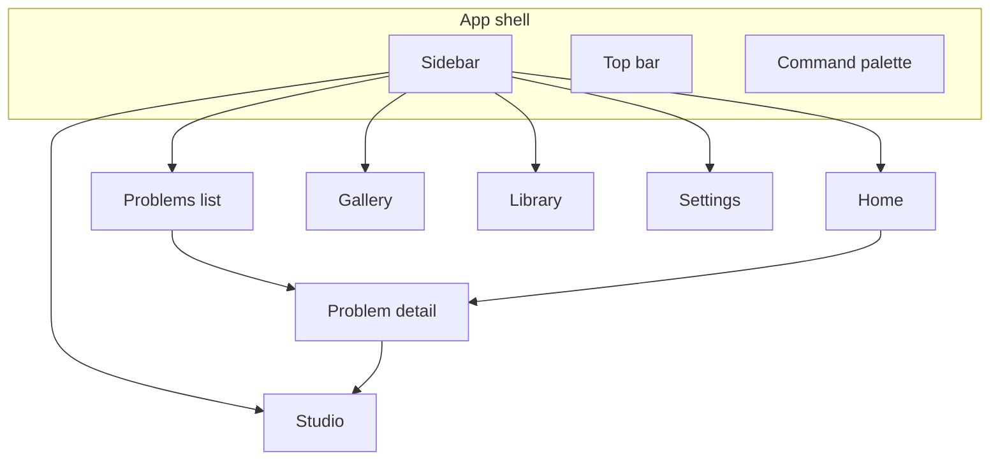

# Arc information architecture v1

Authority: `uploads/PRODUCT_SPEC.md`. Refines navigation and URLs for the product shell.

## Sitemap

## Route model (client `view` + query)

| URL intent | `view` | Query | Primary object |
|------------|--------|-------|----------------|
| Home | `home` | `view=home` | Orientation |
| Problems | `problems` | none | Problem list |
| Problem detail | `problems` | `problem=<id>` | Problem (run) |
| Studio | `studio` | `view=studio` | Diagram editor |
| Gallery | `gallery` | `view=gallery` | Figures |
| Library | `library` | `view=library` | Sources |
| Settings | `settings` | `view=settings` | Workspace config |

Legacy `run=` query redirects to `problem=`. `control-studio` maps to `studio`.

## Sidebar (expanded 240px / collapsed 56px)

1. Logo + workspace label + **New problem**
2. Home · Problems · Studio · Gallery · Library (icons + labels)
3. **Recent** (max 5): human title, subject dot, status
4. Agent status · Settings · Help · Theme toggle

## Top bar

- Left: breadcrumb (`Problems / Voltage divider · Vout`)
- Right: primary action (contextual) + overflow; optional presence chip

## Problem detail regions

1. Answer card (quantities + verification)
2. Tabs: Work · Figures · Diagram · Activity
3. Right drawer: Parameters (stale → Run again)

## Cut from primary surfaces

- Raw run ids, recipe ids, JSON (Diagnostics only)
- Frontier scorecard on Gallery (moves to Settings → About)
- Header engine chips (Settings → Engines)

## Objects glossary

| UI name | Backend | Notes |
|---------|---------|-------|
| Problem | `runs/<id>` | Evidentiary + artifacts |
| Diagram | `graph.json` / Control Studio session |
| Figure | Visual Kit golden / run PNG |
| Source | RAG inventory row |
